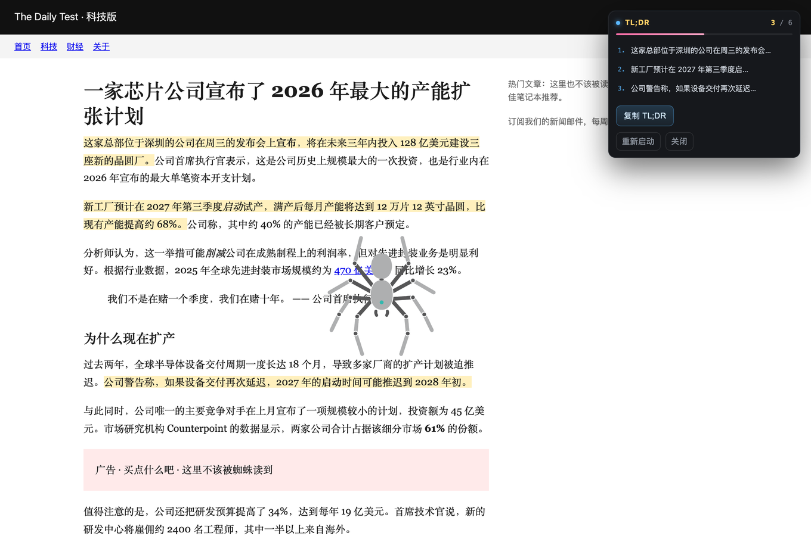
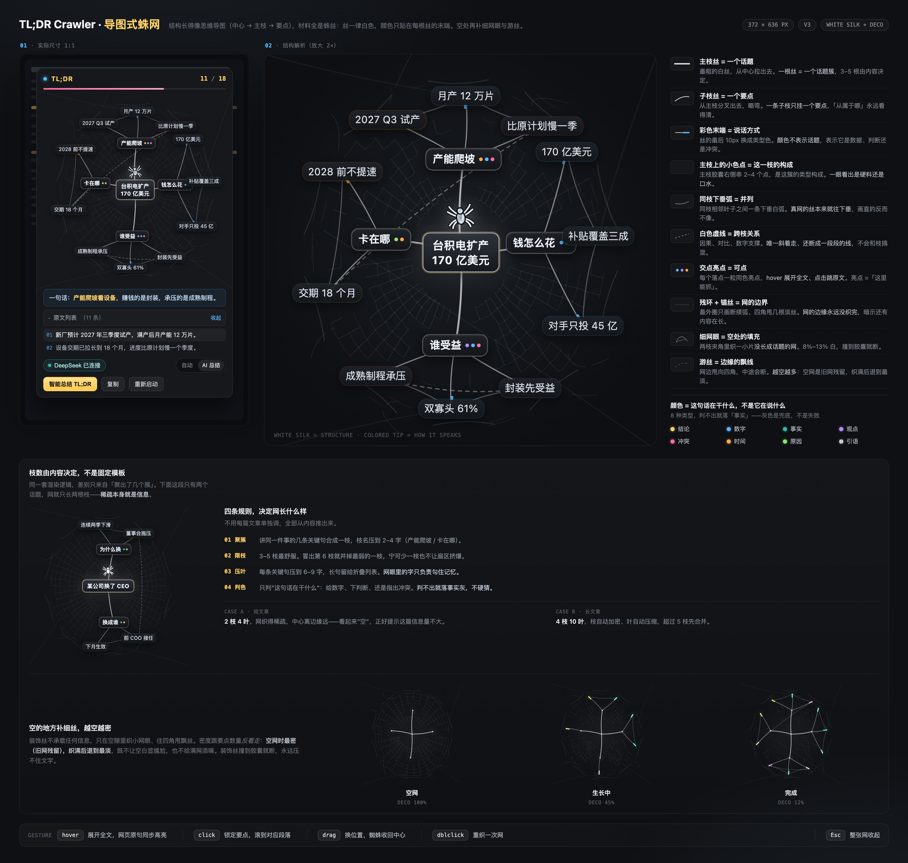
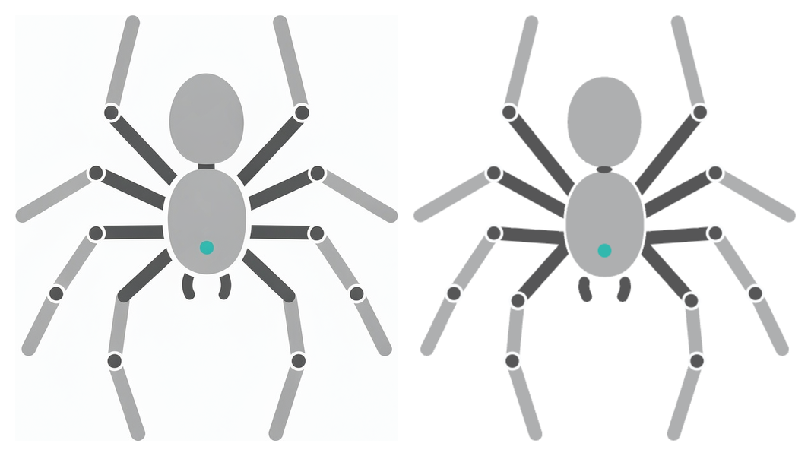

# TL;DR Crawler

> 一只会爬行的蜘蛛，跟随你的光标阅读网页，高亮关键句，并把要点织成一张 TL;DR 蛛网。

[](manifest.json)
[](https://developer.chrome.com/docs/extensions/develop)
[](LICENSE)
[](CONTRIBUTING.md)

一个纯 JavaScript、零第三方依赖的 Chrome 扩展。点一下图标，蜘蛛就会从当前光标位置出发在页面上爬行，把一段段关键句高亮出来；再交给大模型（DeepSeek 或 Claude）提炼成中文要点，实时挂到一张会生长的蛛网图谱上。点蛛网上的任意节点，可以直接展开原文、定位到页面对应句子。

## 预览

**爬行高亮 + TL;DR 要点面板**



**蛛网图谱设计**

要点不是干巴巴的列表，而是按语义聚成枝、用白色蛛丝连成的网；颜色只落在末端节点上，表示内容的说话方式（结论、数据、引语……）。



**蜘蛛造型**（参考图逐像素复刻，canvas 矢量绘制 + 程序化 IK 步态）



## 特性

- 🕷️ **蜘蛛跟随光标爬行**：canvas 矢量蜘蛛 + IK 步态，金属银质感，悬停在关键句上会自动高亮原文。
- 🕸️ **会生长的蛛网图谱**：AI 每批返回要点，网就长出新节点；白丝骨架 + 类型色末端，空网时越空装饰丝越密；分批织网带渐进抽出动画（丝从中心抽出、胶囊由内而外弹出，带节流与减弱动画兜底）。
- 🧠 **双引擎摘要**：支持 DeepSeek 与 Anthropic Claude，设置页可切换、可测连接，强制输出简体中文。
- 💬 **大白话全文总结**：点蛛网中心的标题，基于已抓关键句生成一段 150–250 字的中文白话总结；按需调用、本次会话缓存，内容更新时会提示重讲。
- 📌 **节点详情卡**：点蛛网胶囊展开类型 / 所属枝 / 中文摘要 / 原文全句，一键定位原文或复制。
- 🌫️ **悬停即透明**：鼠标压在面板上时底板与蛛丝自动淡化为半透明，方便对照后面的原文；所有按钮、列表、详情卡保持清晰不褪。
- ⚡ **纯原生实现**：Manifest V3，纯 JS 无构建、无第三方库，Shadow DOM 隔离不干扰宿主页面。
- 🔍 **原文列表兜底**：折叠区保留逐句原文与本地摘要，AI 不可用时仍可阅读。

## 安装

### 从源码加载（开发者模式）

1. 克隆或下载本仓库：
   ```bash
   git clone https://github.com/fjdaj0419/tldr-crawler.git
   ```
2. 打开 Chrome，在地址栏输入 `chrome://extensions`。
3. 打开右上角的 **开发者模式**。
4. 点击 **加载已解压的扩展程序**，选择仓库根目录（含 `manifest.json` 的那一层）。
5. 工具栏出现蜘蛛图标即安装成功。点图标启动 / 关闭。

> ⚠️ 扩展根目录下不要放以 `_` 开头的文件或文件夹（如 `_backup`），Chrome 会拒绝加载。

## 使用

1. （可选）点工具栏图标旁的三点菜单 → **选项**，填入 API Key，选择总结引擎并测试连接。
2. 打开任意一篇长文，移动光标，蜘蛛会爬向关键句并把它们高亮成金色。
3. 右上角面板实时显示 `已踩到 / 总数`，要点随 AI 返回挂到蛛网上。
4. 鼠标悬停蛛网节点高亮对应原句；点击展开详情卡；点面板的 **⤢** 放大蛛网查看全部要点（最多 50 个）。
5. 点蛛网中心的标题可展开全文大白话总结；鼠标停在面板上时面板会自动半透明，方便对照原文。

### 配置 API Key

扩展支持两家服务商，在设置页选择其一即可：

| 引擎 | 配置项 | 说明 |
|---|---|---|
| DeepSeek | `DeepSeek API Key` + 模型 | 默认使用 `deepseek-flash`，可选 `deepseek-v4-pro` |
| Claude | `Anthropic API Key` + 模型 | 使用 Anthropic 官方 API |

不填 Key 也能用：蜘蛛照常爬行高亮、列表保留本地摘要，只是蛛网保持空网状态（这是设计如此，AI 是蛛网唯一数据源）。

## 项目结构

```text
tldr-crawler/
├── manifest.json        # MV3 扩展清单（名称、权限、入口）
├── content.js           # 页面内全部逻辑：蜘蛛 / 高亮 / 面板 / 蛛网图谱 / 交互
├── background.js        # Service Worker：API 代理、批处理、结构化解析
├── options.html / .js   # 设置页：引擎切换、Key 管理、连接测试
├── icon16|48|128.png    # 工具栏与扩展图标
├── spider-body.png      # 蜘蛛身体素材（canvas 绘制参考）
├── screenshots/         # README 展示图
└── LICENSE / CONTRIBUTING.md / .gitignore
```

数据流：`discover` 扫描关键句 → `queueApi` 批量防抖 → `background.summarizeBatch` 调模型 → `parseStructured` 解析 `{topic, items, links}` → 挂回句子 → `rebuildWeb` → `paintWeb` 聚枝 → `renderWebMap` 径向扇出绘制。

## 开发

无构建步骤。直接改源码后，在 `chrome://extensions` 点该扩展的刷新按钮 ↻ 即可生效。面板 header 右上会显示当前版本号，可用于确认加载的是不是最新版。

本项目由 WorkBuddy 协同开发，JS 源码未使用任何第三方库；蛛网视觉与交互细节见 `screenshots/web-map-concept.png`。

## 贡献

欢迎提 Issue 和 PR，见 [CONTRIBUTING.md](CONTRIBUTING.md)。

## 更新日志

- **v2.3.1** — 渐进织网动画：蛛丝从中心抽出、胶囊由内而外弹出，带节流与「减少动画」系统偏好兜底。
- **v2.3.0** — 修「后台没响应」：按需调用先 PING 唤醒空闲的 Service Worker，兼容扩展刚更新后的上下文失效提示。
- **v2.2.9** — 修大白话通道层静默失败：后台必回错误码、前端自动重试一次并显示真实原因。
- **v2.2.8** — 新增「大白话全文总结」：点中心标题看一段中文白话总结。
- **v2.2.7** — 悬浮褪色收窄到只有底板与蛛丝，操作界面不褪。
- **v2.2.6 / v2.2.5** — 鼠标压面板时整体半透明，档位定稿 0.81。
- **v2.2.4** — 要点上限提到 50、要点多时自动放大面板、重新启动清网。
- **v2.2.3** — 面板放大按钮、面板 chrome 中性灰化、细丝提亮、移除网心小蜘蛛。
- **v2.2.2** — 蛛网胶囊点开详情卡。
- **v2.2.1** — 修复字符串 id 解析 / 列表被 flex 压扁 / 强制中文输出。
- **v2.2.0** — 蛛网图谱落地。

## License

[MIT](LICENSE) © 2026 fjdaj0419
