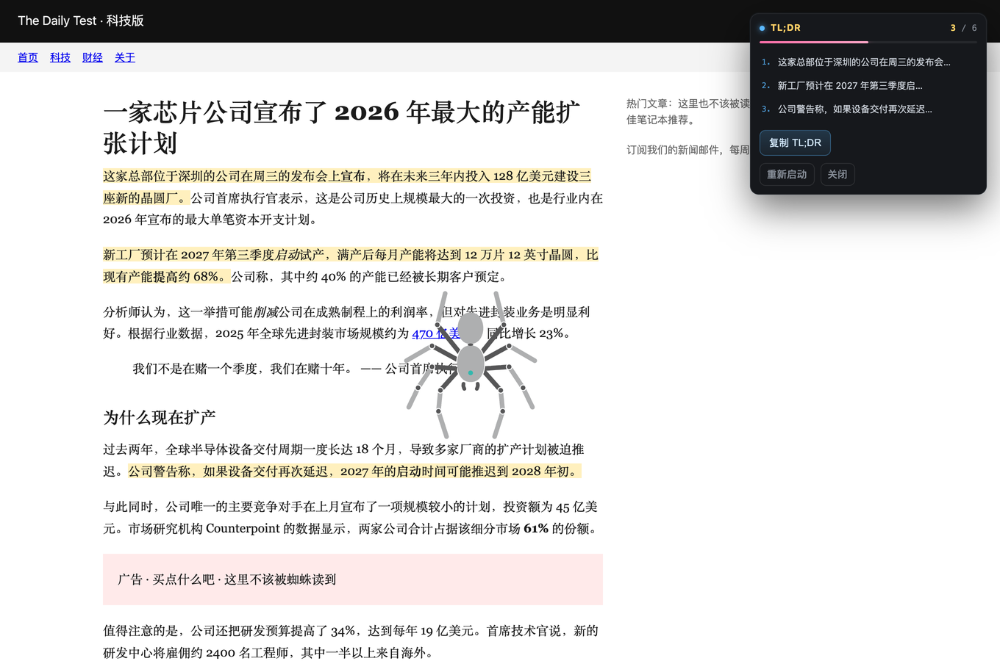
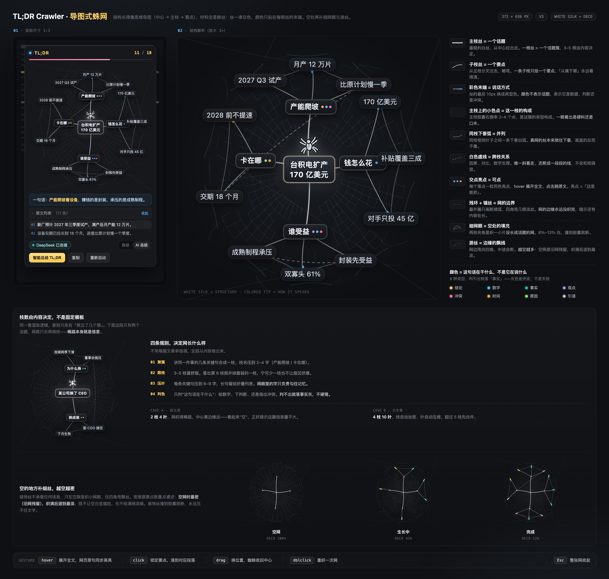
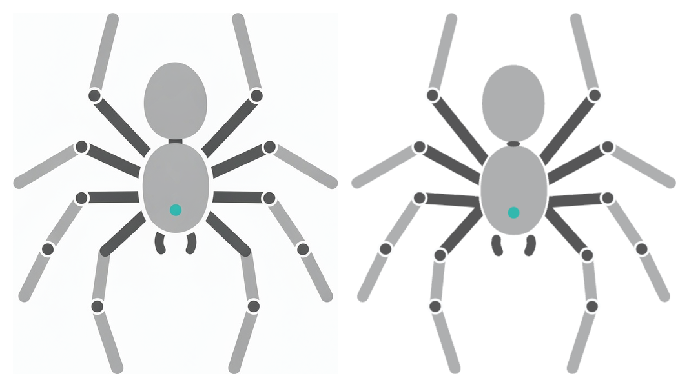

# TL;DR Crawler

[English](README.md) · **简体中文**

> 一只会爬行的蜘蛛，跟随你的光标阅读网页，高亮关键句，并把要点织成一张 TL;DR 蛛网。

[](manifest.json)
[](https://developer.chrome.com/docs/extensions/develop)
[](LICENSE)
[](CONTRIBUTING.md)

一个纯 JavaScript、**零第三方依赖**的 Chrome 扩展。点一下图标，蜘蛛就会从当前光标位置出发在页面上爬行，把一段段关键句高亮出来；再交给大模型（DeepSeek 或 Claude）提炼成中文要点，实时挂到一张会生长的蛛网图谱上。点蛛网上的任意节点，可以直接展开原文、定位到页面对应句子。网还会自己分层：模型读完全文后把内容归纳成「大块 → 话题枝」，所以一封含两场讲座的邮件会长成两大块，而不是一堆平铺的要点。

> **说明**：扩展界面与 AI 生成的全部文本均为简体中文。

## 预览

**爬行高亮 + TL;DR 要点面板**



**蛛网图谱**

要点不是干巴巴的列表，而是按语义聚成枝、用白色蛛丝连成的网；颜色只落在末端节点上，表示内容的说话方式（结论、数据、引语……）。



**蜘蛛造型**（参考图逐像素复刻，canvas 矢量绘制 + 程序化 IK 步态）



## 特性

- 🕷️ **蜘蛛跟随光标爬行**：canvas 矢量绘制 + IK 步态，金属银质感；悬停在关键句上会自动高亮原文。
- 🕸️ **会生长的蛛网图谱**：AI 每批返回要点，网就长出新节点；白丝骨架 + 类型色末端，空网时越空装饰丝越密；带渐进织网动画（丝从中心抽出、胶囊由内而外弹出）。
- 🪜 **层级蛛网**：模型读完全文，把内容归纳成 **大块 → 话题枝 → 句子**，每一层的名字都由内容现场生成（不写死分类，专有名词保留原文）。界面一次展示两层：常态下点带 **›** 的话题枝切到聚焦下钻视图，放大态则在原地向外长出下一层。一封含两场讲座的邀请邮件会长成两大块，而不是一堆平铺要点。
- 🧭 **三级结构降级**：有 AI 归纳结果就用，没有就用 HTML 的 `h2`–`h4` 标题，再没有才退回扁平网。归纳失败不会让网变空。
- 💬 **关键词飞入**：AI 返回要点后，一个 2–6 字的关键词会沿一条贝塞尔蛛丝从原文位置飞向对应胶囊，在胶囊上方停留片刻再淡出。模型没给关键词时，改用正则抽取兜底。
- 📖 **大白话全文总结**：点蛛网中心的标题，让已抓到的关键句被重新讲成一段白话中文；按需生成，本次会话内缓存。
- 🧠 **双引擎摘要**：支持 DeepSeek 与 Anthropic Claude，设置页可切换、可测连接，强制输出简体中文。
- 📌 **节点详情卡**：点蛛网胶囊展开类型 / 所属枝 / 中文摘要 / 原文全句，一键定位原文或复制。
- 🌫️ **悬停半透明**：鼠标压在面板上时，底板与蛛丝淡化为半透明，方便对照后面的原文；按钮、列表等操作界面保持清晰。
- 🩺 **失败可见**：AI 调用失败时，空网会直接写出真实原因（Key 无效、余额不足、返回格式不对、缺少结构化数据），而不是一直转圈。
- 📄 **页面兼容性**：除 `p` / `li` / `blockquote` 外，在页面没有标准文本块时自动退回到「叶子 `div` / `section` / `td`」，因此邮件、文档、后台系统也能读。
- ⚡ **纯原生实现**：Manifest V3，纯 JS 无构建、无第三方库，Shadow DOM 隔离，不干扰宿主页面。
- 🔍 **原文列表兜底**：折叠区保留逐句原文与本地摘要，AI 不可用时仍可阅读。

## 安装

### 从源码加载（开发者模式）

1. 克隆或下载本仓库：
   ```bash
   git clone https://github.com/fjdaj0419/tldr-crawler.git
   ```
2. 打开 Chrome，在地址栏输入 `chrome://extensions`。
3. 打开右上角的 **开发者模式**。
4. 点击 **加载已解压的扩展程序**，选择仓库根目录（含 `manifest.json` 的那一层）。
5. 工具栏出现蜘蛛图标即安装成功。点图标启动 / 关闭。

> ⚠️ 扩展根目录下不要放以 `_` 开头的文件或文件夹（如 `_backup`），Chrome 会把它当作系统保留名并拒绝加载。

## 使用

1. （可选）点工具栏图标旁的三点菜单 → **选项**，填入 API Key，选择总结引擎并测试连接。
2. 打开任意一篇长文，移动光标，蜘蛛会爬向关键句并把它们高亮成金色。
3. 右上角面板实时显示 `已踩到 / 总数`，要点随 AI 返回挂到蛛网上。
4. 鼠标悬停蛛网节点高亮对应原句；点击展开详情卡。带 **›** 的胶囊是话题枝——点它在常态下钻到下一层、在放大态原地展开。点面板的 **⤢** 放大蛛网查看全部要点（最多 50 个）。
5. 点蛛网中心的标题可展开全文大白话总结；鼠标停在面板上时面板会自动半透明，方便对照原文。

### 配置 API Key

扩展支持两家服务商，在设置页选择其一即可：

| 引擎 | 配置项 | 说明 |
|---|---|---|
| DeepSeek | `DeepSeek API Key` + 模型 | 默认 `deepseek-flash`，也可选 `deepseek-v4-pro` |
| Claude | `Anthropic API Key` + 模型 | 使用 Anthropic 官方 API |

不填 Key 也能用：蜘蛛照常爬行高亮、列表保留本地摘要，只是蛛网保持空网状态（这是设计如此，AI 是蛛网唯一数据源）。

## 项目结构

```text
tldr-crawler/
├── manifest.json        # MV3 扩展清单（名称、权限、入口）
├── content.js           # 页面内全部逻辑：蜘蛛 / 高亮 / 面板 / 蛛网图谱 / 交互
├── background.js        # Service Worker：API 代理、批处理、结构化解析
├── options.html / .js   # 设置页：引擎切换、Key 管理、连接测试
├── icon16|48|128.png    # 工具栏与扩展图标
├── spider-body.png      # 蜘蛛身体素材（canvas 绘制参考）
├── screenshots/         # README 展示图
└── LICENSE / CONTRIBUTING.md / .gitignore
```

## 工作原理

```text
discover → queueApi（批 12、防抖 800ms）→ background.summarizeBatch
        → parseStructured { topic, items[id, short, kw, branch, type], links }
        → 挂回句子 → paintWeb → renderWebMap 径向布局
        → spawnKeywords（把新增的关键词飞进各自胶囊）

（最后一批完成、空闲 3 秒后）background.structureArticle
        → parseStructure { topic, blocks[name, topics[name, ids]] }
        → 挂 s.struct = { block, topic } → rebuildWeb（层级树）
```

- 扫描器收集文本块（`p`、`li`、`blockquote`、`h2`–`h4`）；若标准块少于 3 个，退回到「叶子 `div` / `section` / `td`」。
- 句子用 DOM `Range` 切分并打分，得分最高的约 25% 成为关键句。
- 不足 12 字的短标签行（`Talk 1:`、`Abstract:`、`Speaker:` 这类）不会独立成句，而是作为 `hint` 挂到后一个块上——这样层级归纳仍能看见分节信号，同时又不动用于高亮的 `Range`。
- 蜘蛛是「走到句子上」才算发现：发现时高亮、加入列表并排队送模型。
- 层级归纳每次会话只跑一次，在爬取空闲 3 秒后发出；结果优先于 HTML 标题，失败则静默降级，不会把网弄空。
- 结构化解析容忍字符串数字、模型重编号、```` ```json ```` 包裹，以及常见 JSON 小错（尾逗号、中文引号、值缺引号）。

## 开发

无构建步骤。改完源码后，在 `chrome://extensions` 点该扩展的刷新按钮 ↻ 即可生效。面板 header 右上会显示当前运行版本号——用它确认你没有在测旧版本。

JS 源码未使用任何第三方库；蛛网视觉与交互细节见 `screenshots/web-map-concept.png`。

## 常见问题

| 现象 | 含义 |
|---|---|
| 面板显示 `0 / 0`、原文列表 0 条 | 页面没有可扫描的文本块。最常见的原因是正文在 `iframe` 里，content script 跨不过去。 |
| 计数大于 0 但蛛网一直空着 | AI 调用失败。空网现在会直接打印原因（Key 无效、余额、格式不对等）。 |
| 更新后版本号没变 | 先刷新扩展，再刷新网页；仍不变就移除扩展后重新加载。 |

## 更新日志

- **v2.5.0** — AI 动态层级归纳：爬取空闲后把全文交给模型，由它归纳出「大块 → 话题枝 → 句子」，类名现场起、不写死、专有名词保留原文。短标签（`Talk 1:` 这类）作为 `hint` 保留，靠标签分节的邮件不再丢结构。分支上限放宽（普通态 24 点、最多 12 枝）。
- **v2.4.0** — 层级蛛网：第一层取 HTML `h2` 子部分，第二层取 AI 话题枝，句子收进 `kids`；常态聚焦下钻、放大态原地长分支。
- **v2.3.6** — 页面兼容：页面没有标准文本块时退回到「叶子 `div` / `section` / `td`」（邮件、文档、后台系统）。
- **v2.3.5** — 修大白话卡按钮跑出框（改为填完内容再量高度）；飞词放慢、字号加大、缓动改为缓入缓出。
- **v2.3.4** — 空网不再装死，直接显示 AI 失败的真实原因。
- **v2.3.3** — 修「网全空」回归：改写 `kw` 提示措辞、增加 JSON 宽松修复、`max_tokens` 提到 4000。
- **v2.3.2** — 关键词飞入：关键词沿蛛丝从原文飞向胶囊。
- **v2.3.1** — 渐进织网动画（丝从中心抽出、胶囊由内而外弹出）。
- **v2.3.0** — 按需调用前先 PING 唤醒 Service Worker，扛住冷启动。
- **v2.2.9** — 大白话通道失败时显示真实错误。
- **v2.2.8** — 全文大白话总结。
- **v2.2.7 / v2.2.6 / v2.2.5** — 悬停半透明，档位定稿 0.81。
- **v2.2.4** — 要点上限提到 50，要点多时自动放大面板。
- **v2.2.3** — 面板放大、chrome 中性灰化、细丝提亮。
- **v2.2.2** — 节点详情卡。
- **v2.2.1** — 修字符串 id、列表被压扁、强制中文输出。
- **v2.2.0** — 蛛网图谱落地。

## 贡献

欢迎提 Issue 和 PR，见 [CONTRIBUTING.md](CONTRIBUTING.md)。

## License

[MIT](LICENSE) © 2026 fjdaj0419
